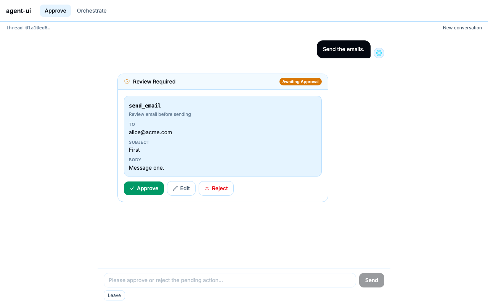

# Full-stack agentic chatbot

**Agents that ask before they act.** Two chatbots on real LangGraph agents: one pauses for
your approval before every sensitive action, the other plans a job, delegates it to a team of
subagents, and writes code on its own isolated Linux machine, with you approving each file
write and shell command.

**Live demo:** [fullstack-agent-ui.vercel.app](https://fullstack-agent-ui.vercel.app)
(password-protected, because every message spends model credit; the password is available on
request, or [run it yourself](#quickstart) with your own key in two minutes).



## Highlights

- **Human-in-the-loop, for real.** Approvals are LangGraph interrupts, not UI state. The agent
  stops before `send_email`, the card shows exactly what would run, and you **approve, edit
  the arguments, or reject with a reason**. Close the tab and the card is still waiting.
- **An approval card per action, correctly resolved.** Several pending actions get several
  cards; nothing runs until every one is answered, and a decision can never be applied to the
  wrong action. Covered by unit and browser tests.
- **An isolated sandbox per conversation.** The `/orchestrate` coder reads, edits and runs
  commands on its own Linux machine, created per thread and deleted an hour after idle.
  Nothing is shared between conversations, and every shell command is shown to you first.
- **A real IDE view of what the agent did.** File tree plus before/after diffs. The baseline
  is a git commit made when the machine is seeded, so a reload cannot lose it.
- **Plan, delegate, reason, live.** A Sonnet supervisor writes a todo list and hands topics to
  Haiku workers. Each subagent is a card you can expand to watch its own tools and thinking
  stream.
- **👍 / 👎 on every answer**, stored as LangSmith feedback and kept across branch switches
  and reloads.
- **Branch, retry, stop, rejoin.** Edit or retry any message and flip between branches with a
  `‹ 1/2 ›` switcher. Stop cancels the run on the server, and a reloaded page rejoins the
  run still in progress.
- **Safe to leave on the internet.** A password gate in front of the page and again in front
  of the agent proxy; the browser never sees the agent URL or any API key.
- **Tested without spending a cent.** 78 pytest, 37 Vitest, and 13 Playwright tests run
  against a fake agent built from recorded traffic. No API key needed.

## The stack

| Layer | What | Notes |
| --- | --- | --- |
| UI | Next.js 16 (App Router), React 19, TypeScript, Tailwind v4 | Vercel |
| Agent client | `@langchain/react` `useStream`, `@langchain/langgraph-sdk` | Streaming, interrupts, branching |
| Edge | Route-handler proxy plus password gate (`proxy.ts`) | Adds the LangSmith key server-side; streams unbuffered |
| Agents | Python 3.12, LangGraph, LangChain `create_agent`, `deepagents` | `HumanInTheLoopMiddleware`, a deep-agent supervisor |
| Models | Claude Sonnet 5 (supervisor), Claude Haiku 4.5 (workers) | Adaptive extended thinking |
| Sandbox | LangSmith Sandboxes | One Linux machine per thread, git-backed diffs |
| Persistence | LangSmith Deployment (managed Postgres and Redis) | Threads, checkpoints and pending approvals live here |
| Feedback | LangSmith feedback API | Behind custom Starlette routes |
| Quality | pytest, Vitest, Playwright, GitHub Actions | CI gates both deploys |

## Trying it

| | |
| --- | --- |
| **Use the live demo** | Ask me for the password. It exists so the demo cannot be used to run up someone else's bill. |
| **Run it with your own key** | [Quickstart](#quickstart). Your keys stay in `packages/agent/.env` on your machine and never pass through anyone else's server. |
| **Just read it** | [Architecture](#architecture), then `docs/BUILD.md`. |

## Architecture

Two processes, deployed separately, that only talk over HTTP.

```
Browser                         never holds a key, never leaves the origin
   │  /api/langgraph/...
   ▼
packages/web    Next.js 16 on Vercel
                routes the two chats, and proxies every agent call,
                injecting the LangSmith key server-side
   │  https://<id>.us.langgraph.app      (http://127.0.0.1:2024 locally)
   ▼
packages/agent  Python on LangSmith Deployment
                LangGraph server: two graphs, threads, checkpoints,
                managed Postgres + Redis
   ▼
Anthropic API
```

**Next.js does two jobs:** it serves the pages, and it proxies every agent call so the
API key stays server-side and the browser only ever talks to its own origin.

**How the browser reaches the agent.** The agent server is deployed on LangSmith at a
public HTTPS URL, but it rejects any request without a LangSmith API key in the
`X-Api-Key` header. To keep that key out of the browser, the browser only talks to my
Next.js app on Vercel. A catch-all route handler there, which runs as a serverless
function, takes any path the browser calls under `/api/langgraph/`, swaps that prefix for the agent's base URL, adds the key from a server-side env var, and forwards the request to the agent URL. It streams the response back unbuffered. The proxy doesn't know what any path means. The LangGraph server decides what each endpoint does. The browser never sees the agent URL or the key.

**Custom endpoints.** `packages/agent/http_app.py` adds our own endpoints (for the
sandbox and user feedback) alongside the LangGraph agent server's built-in ones. The
browser reaches them the same way as the built-in ones: through the Next.js route handler
running as a Vercel serverless function. `langgraph.json` accepts only one extra app, so
`http_app.py` is a single Starlette app that mounts the two route modules.

```
browser
  │  https://your-app.vercel.app/api/langgraph/<anything>
  ▼                                   (same origin, no key)
Vercel serverless function: app/api/langgraph/[...path]/route.ts
  │  strips /api/langgraph, adds X-Api-Key
  ▼
LangSmith Deployment: ONE public URL, https://<id>.us.langgraph.app
┌──────────────────────────────────────────────────────────────────────┐
│ LangGraph Server (one process, decides by path)                      │
│                                                                      │
│  built-in routes                     custom routes                   │
│  /threads, /runs/stream, ...         /sandbox/{thread}/tree          │
│       │                              /sandbox/{thread}/file          │
│       │                              /sandbox/{thread}/changes       │
│       │                              POST /sandbox/{thread}/baseline │
│       │                              POST /feedback/{thread}         │
│       │                              /feedback/{thread}/votes        │
│       │                                     │                        │
│       │                          langgraph.json: "http": {"app":     │
│       │                            "./http_app.py:app"}              │
│       │                                     │                        │
│       │                              http_app.py                     │
│       │                              one Starlette app, mounts:      │
│       │                                ├─ routes/sandbox_files.py    │
│       │                                └─ routes/feedback.py         │
│       ▼                                     │                        │
│  graphs from langgraph.json                 │                        │
│   human_in_the_loop, orchestrator           │                        │
└───────┬─────────────────────────────────────┼────────────────────────┘
        ▼                                     ▼
   Anthropic API                 LangSmith sandbox  (tree/file/changes)
   (+ sandbox for the coder)     LangSmith API      (feedback)
```

**One agent deployment serves both chats.** LangSmith owns the checkpointer, so threads,  
branches and pending approvals live in its managed Postgres — which is why a run  
survives a closed tab.

## What is built


### `/approve` — one agent, one gated tool

The agent proposes sending an email and stops. You approve, edit or reject it.


| Capability         | What it does                                                                  |
| ------------------ | ----------------------------------------------------------------------------- |
| Interrupt / resume | The agent pauses before a sensitive tool; the card survives a reload          |
| Branching          | Edit or Retry any message, with a `‹ 1/2 ›` switcher between branches         |
| Rejoin             | Reload or navigate away and come back to the same conversation, still running |
| Stop               | Cancels the run server-side, not just the spinner                             |
| Tool-call cards    | Arguments and results, attached to the turn that made the call                |


### `/orchestrate` — a deep agent that plans, delegates and writes code

A Sonnet supervisor writes a plan, hands topics to Haiku workers, and delegates coding to
a subagent with **a real Linux machine**. Every file write and every shell command stops
for approval, wherever it happens — including inside a worker.


| Capability            | What it does                                                                                                                       |
| --------------------- | ---------------------------------------------------------------------------------------------------------------------------------- |
| Plan panel            | The agent's live todo list, from `TodoListMiddleware`                                                                              |
| Subagent cards        | One per delegation, attached to the turn that delegated it; expand to watch that worker's own messages, tools and reasoning stream |
| Reasoning traces      | Extended thinking rendered for the supervisor and every worker                                                                     |
| Sandbox               | A per-conversation machine. The coder reads, edits and runs commands on it; nothing is shared between conversations                |
| Approval on `execute` | A shell command is shown to you before it runs. Nothing else in the app has a shell to gate                                        |
| File tree and diffs   | The workspace as the agent changes it, with a source-control view of what this run touched                                         |
| Approval, nested      | A worker's `write_file` raises a card on the page and resumes correctly                                                            |


The page is a two-column chat until a conversation needs code, then becomes a
three-column IDE — a code pane that sits empty takes the width the conversation needs.

### How the sandbox works

Each conversation gets its own Linux machine, named after its thread id, created when the
run starts and deleted an hour after it goes idle. Nothing is shared between
conversations.

The coder is a **separate compiled agent**, not just a named helper, because a helper can
be given its own model but not its own filesystem — and a different filesystem is the
whole point. It carries its own approval rules, which is why `execute` is gated there and
nowhere else: nothing else in the app has a shell.

The browser never talks to the machine, because reaching it needs a credential. The agent
server reads the files and the page asks the agent server:

```
browser ──► Next.js proxy ──► agent server ──► the machine
                              /sandbox/{thread}/tree      the file list
                              /sandbox/{thread}/file      one file, now or before
                              /sandbox/{thread}/changes   what this run touched
```

**The diff is a git commit, not a copy held in the browser.** The workspace is committed
when the machine is seeded, so "what did this look like before" is `git show HEAD:<file>`
and "what changed" is `git diff`. The obvious alternative — remember the files in the
page — loses everything on reload, and then silently reports that nothing changed.

## Why it holds up

Every behaviour above is server state, not UI state. Approvals are LangGraph interrupts
answered by id, branches are real checkpoints, a run keeps going on the server while
nobody is watching, and the diff is a git commit on the sandbox rather than a copy the
browser is holding — so a reload cannot lose it.

That last one is the rule the rest follows from: anything the page has to *remember* is
something a reload can take away. The parts that took the most care — resolving several
pending approvals without ever running an action the user did not click, and keeping
per-worker streams subscribed only while their card is open — are written up with the
measurements behind them in `docs/`.

## Stack


|           |                                                                                          |
| --------- | ---------------------------------------------------------------------------------------- |
| Frontend  | Next.js 16 (App Router), React 19, TypeScript 5.9, Tailwind v4                           |
| Agent SDK | `@langchain/react` `useStream` + selector hooks, `@langchain/langgraph-sdk`              |
| Agents    | Python 3.12, LangGraph, LangChain, `deepagents` 0.7                                      |
| Models    | Claude Sonnet 5 (supervisor, adaptive thinking), Claude Haiku 4.5 (workers)              |
| Sandbox   | LangSmith Sandboxes — one Linux machine per conversation, 10 min idle / 1 hour to delete |
| Hosting   | Vercel (web) + LangSmith Deployment (agent), both redeploy on push                       |
| Tooling   | uv (Python), pnpm, Make                                                                  |


## Quickstart

Needs Node 22+ (`.nvmrc` says 24), pnpm, [uv](https://docs.astral.sh/uv/), GNU Make,
and an [Anthropic API key](https://console.anthropic.com/). uv fetches the right Python
itself, so you do not need one installed.

```bash
cp .env.example packages/agent/.env     # then add ANTHROPIC_API_KEY
make install                            # uv sync + pnpm install
make dev-next                           # agent :2024 + Next.js :4200
```

Open [http://localhost:4200](http://localhost:4200).

Locally the app is open: no `WEB_PASSWORD`, no login. On a deploy, set `WEB_PASSWORD` in
Vercel; a production build with none refuses everyone rather than serving the app open.

`packages/web/.env.local` is optional locally — `AGENT_SERVER_URL` defaults are in
`.env.local.example`, and `langgraph dev` needs no API key.


| Command          | Runs                                                 |
| ---------------- | ---------------------------------------------------- |
| `make dev-next`  | agent + Next.js app — **this is the project**        |
| `make dev-agent` | LangGraph server only, port 2024                     |
| `make dev-web`   | Next.js only, port 4200                              |
| `make typecheck` | `tsc --noEmit` — the only automated gate             |
| `make dev`       | agent + the old Vite app, port 4100 (reference only) |


## Layout


| Path                | What                                                                                                |
| ------------------- | --------------------------------------------------------------------------------------------------- |
| `packages/web`      | **The app.** Next.js 16 App Router, Tailwind v4                                                     |
| `packages/agent`    | The Python graphs — a uv project. `langgraph.json` registers `human_in_the_loop` and `orchestrator` |
| `packages/frontend` | The original Vite app, kept as a reference. Not part of the system                                  |


## Troubleshooting

- **The UI behaves unlike the Python code.** If port 2024 is taken, `langgraph dev`
quietly starts on a random port while the app keeps talking to 2024. Check with
`lsof -nP -iTCP:2024 -sTCP:LISTEN`.
- `pnpm` **fails with** `URL.canParse is not a function`**.** Node older than 22. Run
`nvm use` in the repo root, in each new terminal.
- **Agent dependencies look wrong.** They are pinned in `packages/agent/uv.lock`. Run
`uv sync` from `packages/agent` to match it exactly, or `uv lock --upgrade` to move
them deliberately.
- **No reasoning appears.** Extended thinking is model-dependent. Sonnet 5 takes
`{"type": "adaptive", "display": "summarized"}`; without `display` the default is
`"omitted"` and no reasoning blocks are returned at all — silently. Pre-4.7 models
take `{"type": "enabled", "budget_tokens": N}` and reject the adaptive form with a 400.
- **Inspect server state directly.** `curl localhost:2024/threads/<id>/state` is the
truth; `threads/search` returns a stale snapshot.

